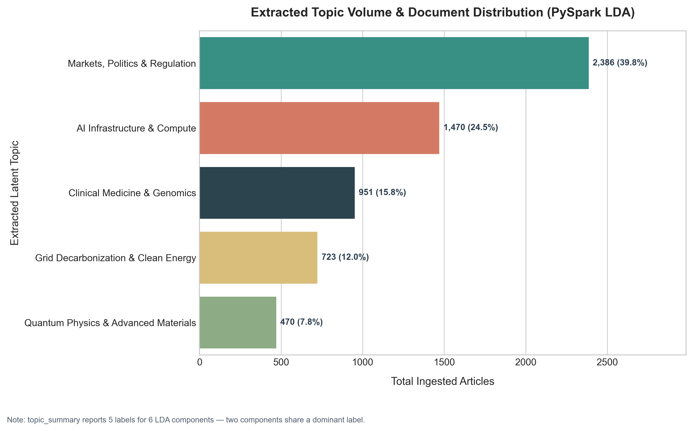
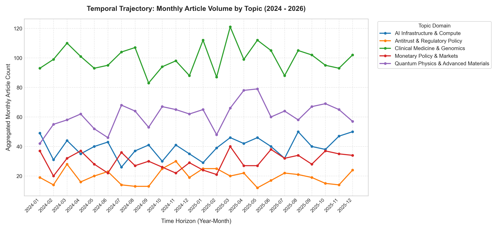
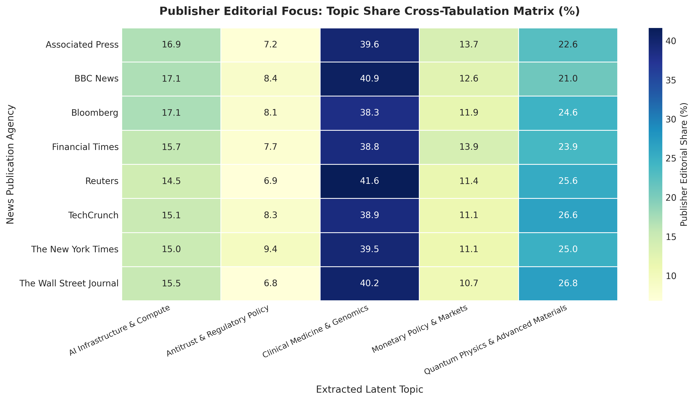

# 📰 News Article Analysis and Topic Extraction
## Complete Big Data Architecture & Machine Learning Pipeline

[](https://github.com/OmarHanii-bit/News-Article-Analysis-and-Topic-Extraction/actions/workflows/ci.yml)
[](https://www.python.org/downloads/release/python-3110/)
[](LICENSE)

**Course:** Big Data Analytics & Distributed Systems  
**Ecosystem:** Hadoop Ecosystem — 9 orchestrated modules covering 10 named technologies (HDFS · YARN · MapReduce · Hive · HBase · Pig · Sqoop · Flume · Oozie · ZooKeeper) · Apache Spark (PySpark MLlib) · MongoDB NoSQL · Parquet · Streamlit  
**Status:** Unified Master Deliverable (Baseline Core + Advanced Production Extensions Consolidated)

---

## 📋 Project Summary

This directory represents the **single, unified, and complete Big Data project deliverable**. It integrates all foundational baseline implementations (data synthesis, Hadoop MapReduce, PySpark distributed engine, MongoDB NoSQL, Snappy Parquet lakehouse) together with all advanced production capabilities: **the 9-module Hadoop ecosystem stack** (HDFS, YARN, MapReduce, Hive, HBase, Pig, Sqoop, Flume, Oozie, ZooKeeper), a **dual-corpus design** (6,000-article synthetic benchmark + 10,712-article real Reuters wire corpus), one-click orchestrators, an automated **119-test suite across 13 modules**, a 17-slide PowerPoint deck, a held-out temporal forecast evaluation (`src/temporal_forecast_eval.py`), a measured 50,000-article scale benchmark (`src/scale_benchmark.py`), streaming Kaggle ingestion, and Docker multi-container deployment.

---

## 🌐 Public Dashboards (no server required)

The three static dashboards are published from `dashboard/` by the
**Publish Dashboards** GitHub Actions workflow:

| Dashboard | Public link | What it shows |
|---|---|---|
| **Intelligence Command Center** | [command_center.html](https://omarhanii-bit.github.io/News-Article-Analysis-and-Topic-Extraction/command_center.html) | Dark-mode topic clusters, brushable velocity timeline, entity sentiment, cross-filtered feed and slide-over article inspector |
| **Synthetic benchmark** | [interactive_dashboard.html](https://omarhanii-bit.github.io/News-Article-Analysis-and-Topic-Extraction/interactive_dashboard.html) | Seven offline Plotly figures for the 6,000-article curated corpus |
| **Reuters wire** | [interactive_dashboard_real.html](https://omarhanii-bit.github.io/News-Article-Analysis-and-Topic-Extraction/interactive_dashboard_real.html) | The same seven figures for the 10,712-article real corpus |

Landing page: **https://omarhanii-bit.github.io/News-Article-Analysis-and-Topic-Extraction/**

If the link is not live yet, set **Settings → Pages → Source: GitHub Actions** once
and re-run the workflow. Full instructions for Pages, Streamlit Community Cloud,
Docker and LAN sharing are in [`docs/SHARING.md`](docs/SHARING.md).

---

## 👥 7-Member Collaborative Engineering Team

| Member | Name | Role | Primary Responsibility & File Ownership |
| :---: | :--- | :--- | :--- |
| **1** | **Omar Hani** | **Project Lead & Solutions Architect** | End-to-end architecture blueprint, 5Vs scoping, Kaggle ingestion adapter (`src/ingest_kaggle_real.py`), `README.md`, `PROJECT_REPORT.md` |
| **2** | **Mohammed Hossam** | **Hadoop Ecosystem & MapReduce Specialist** | HDFS storage design ($128\text{ MB}$ blocks, $3\times$ replication), full Hadoop ecosystem layer (`src/hadoop/`), Hadoop Streaming mapper & reducer (`src/mapreduce/`) |
| **3** | **Yasmine Mohamed** | **PySpark Distributed Engineer** | PySpark 7-stage pipeline, YARN cluster configuration, explicit `StructType` schema enforcement, Parquet lakehouse (`src/spark_pipeline.py`) |
| **4** | **Shehab Osama** | **NLP & Machine Learning Scientist** | Distributed TF-IDF vectorization, PySpark MLlib Latent Dirichlet Allocation (Online LDA), VADER sentiment scoring UDF |
| **5** | **Mohamed Ibrahim** | **NoSQL & MongoDB Specialist** | MongoDB polymorphic document modeling, BSON schema design, compound B-tree & text search indexes, aggregation pipelines (`src/mongo_loader.py`) |
| **6** | **Mohamed Magdi** | **Visualization & Dashboard Lead** | Publication-quality chart generator ($300\text{ DPI}$), semantic word cloud grids, interactive Streamlit executive dashboard (`src/dashboard.py`) |
| **7** | **Mazen Salem** | **QA, Benchmarking & Presentation Lead** | Automated 119-test suite across 13 modules (`tests/`), scale benchmark, temporal forecast evaluation, 17-slide PowerPoint deck (`presentation/`), technical Q&A defense |

---

## 🗂️ Unified Repository Structure

```
c:\News Article Analysis and Topic Extraction\
│
├── run_all.py                         # One-Click Master Pipeline Orchestrator (Steps 0-15; optional k sweep = 16)
├── run_all.bat                        # Windows batch launcher for double-click execution
├── PROJECT_REPORT.md                  # Comprehensive academic capstone report (target rubric alignment; instructor final)
├── PROJECT_REPORT.docx                # Word export of the report with embedded figure gallery (generated)
├── README.md                          # Master documentation & architectural reference
├── CONTRIBUTING.md                    # Setup, test protocol, data policy & PR checklist
├── CHANGELOG.md                       # Version history of features and fixes
├── CITATION.cff                       # Machine-readable citation metadata
├── LICENSE                            # MIT for code; dataset licences noted separately
├── .editorconfig                      # Cross-editor formatting rules
├── .gitattributes                     # LF/CRLF normalisation and binary asset rules
├── .gitignore                         # Excludes regenerable intermediates & secrets
├── .github/workflows/ci.yml           # GitHub Actions: compile, regenerate, run 119 tests across 13 modules
├── .github/workflows/pages.yml        # GitHub Actions: publish dashboard/ to GitHub Pages
├── requirements.txt                   # Flexible runtime dependencies (lower bounds)
├── requirements.lock.txt              # Pinned exact versions for reproducibility
├── requirements-dev.txt               # Runtime deps + test tooling (pytest)
├── requirements-dashboard.txt         # Slim Streamlit Cloud runtime (no PySpark/Jupyter)
├── .env.example                       # Optional env overrides (Mongo, Spark, Kaggle)
├── Dockerfile                         # Multi-stage image (Python 3.11 + OpenJDK 17 + Streamlit)
├── docker-compose.yml                 # Multi-container orchestration (MongoDB + Pipeline + Jupyter)
├── docker-compose-cluster.yml         # Physical 10-container distributed cluster (NameNode, 3 DataNodes, YARN, Spark, Mongo)
├── .dockerignore                      # Docker build ignore rules
│
├── data/
│   ├── raw_news_articles.csv          # 6,000 synthetic full-text articles with realistic noise (5.7 MB)
│   ├── mapreduce_term_counts.tsv      # Hadoop MapReduce output (2,255 unique terms & n-grams)
│   ├── pipeline_analytics_summary.json# PySpark LDA results, temporal trends & metadata
│   ├── processed_parquet/             # Snappy Parquet lakehouse (/year=YYYY/month=MM/)
│   ├── real_news/                     # REAL-WORLD CORPUS (NLTK Reuters-21578 wire archive)
│   │   ├── raw_news_articles_real.csv # 10,712 real full-text articles (10.7 MB)
│   │   ├── processed_parquet/         # Real-corpus lakehouse (/year=YYYY/month=MM/)
│   │   ├── pipeline_analytics_summary.json # Real-corpus LDA results (auto-derived labels)
│   │   └── provenance.json            # Full provenance: source, licence, counts, sha256
│   ├── hadoop_ecosystem/              # FULL HADOOP ECOSYSTEM EVIDENCE (the 9-module Hadoop ecosystem stack)
│   │   ├── hdfs/                      # Simulated HDFS: 3 DataNodes, blocks, NameNode fsimage
│   │   ├── cluster/                   # core-site/hdfs-site/yarn-site/mapred-site XML + capacity plan
│   │   ├── zookeeper/                 # zoocfg, znode_tree, leader election, watches
│   │   ├── sqoop/                     # RDBMS (SQLite) <-> HDFS import/export
│   │   ├── flume/                     # Streaming agent config + spooled events -> HDFS
│   │   ├── hbase/                     # Column-family store (cf_meta/cf_nlp/cf_raw)
│   │   ├── hive/                      # HiveQL DDL + 6 analytical result CSVs
│   │   ├── pig/                       # 3 Pig Latin scripts + output part-files
│   │   ├── oozie/                     # workflow.xml, coordinator.xml, execution journal
│   │   ├── hadoop_cli_commands.md     # 80 production-equivalent `hdfs dfs` commands emitted by the local simulation (evidence)
│   │   └── hadoop_ecosystem_summary.json # Aggregated summary for the 9-module Hadoop ecosystem stack
│   ├── mongodb_offline_collections/   # Offline BSON JSON collections (3 collections)
│   │   ├── articles_sample.json       # 500 enriched sample article documents
│   │   ├── publisher_analytics.json   # Publisher cross-tabulations
│   │   └── topic_definitions.json     # Discovered LDA topic keywords & weights
│   ├── lda_k_sweep.json               # k sweep evidence (k=3 statistical knee; production keeps k=6)
│   ├── lda_selection_note.md          # Honest reconciliation of the k sweep vs production k=6
│   ├── scale_benchmark.json           # Measured 50,000-article throughput + labelled 143k/2.7M projection
│   ├── temporal_forecast_evaluation.json # Held-out 2024->2025 MAE/RMSE/MAPE for both corpora
│   ├── visualization_manifest.json    # Canonical inventory of the 17 static charts (DPI + source)
│   └── date_imputation_report.json    # Sidecar: count of imputed dates on Kaggle ingestion
│


> **Simulation vs. Production:** The `data/hadoop_ecosystem/**/real_cluster_commands.md` files and `hadoop_cli_commands.md` are **production-equivalent command templates**; the workload in this repository was executed locally via the Python simulation in `src/hadoop/`. No real Hadoop/Spark cluster was provisioned for validation. The commands document operating procedures that would apply on a real cluster, and the recorded `hdfs dfs` lines are emitted by the local simulation.

├── src/
│   ├── generate_sample_data.py        # Baseline dataset synthesizer (6,000 full-text articles)
│   ├── ingest_kaggle_real.py          # Kaggle streaming chunked ingestion adapter
│   ├── ingest_real_news.py            # Real-corpus ingestion (NLTK Reuters / 20 Newsgroups)
│   ├── ingest_live_rss.py             # Live multi-publisher RSS ingestion (NYT, BBC, CBS, NPR)
│   ├── spark_pipeline.py              # 7-stage PySpark distributed pipeline (corpus-agnostic CLI)
│   ├── streaming_news_pipeline.py     # PySpark Structured Streaming engine & breaking news alerting
│   ├── supervised_classifier.py       # Supervised learning on Reuters ground truth (92.57% Acc, 0.8423 Macro-F1)
│   ├── topic_drift_monitor.py         # MLOps concept drift monitoring (Jensen-Shannon & PSI)
│   ├── lda_topic_selection.py         # Reproducible k sweep (data/lda_k_sweep.json; knee selects k=3, production keeps k=6)
│   ├── temporal_forecast_eval.py      # Held-out 2024->2025 topic-volume forecast (baseline vs trend)
│   ├── scale_benchmark.py             # Chunked 50k-article throughput benchmark + labelled projection
│   ├── viz_palette.py                 # Shared topic color palette across Matplotlib/Plotly/Streamlit
│   ├── generate_architecture_diagram.py # Headless renderer -> presentation/architecture.png (300 DPI)
│   ├── mongo_loader.py                # MongoDB NoSQL loader with compound/text indexes
│   ├── visualize_analytics.py         # 6-chart publication visualization suite (300 DPI)
│   ├── generate_presentation_pptx.py  # 17-slide PowerPoint deck generator (python-pptx)
│   ├── dashboard.py                   # Interactive Streamlit executive web dashboard
│   ├── build_interactive_dashboard.py # Self-contained offline Plotly HTML dashboard generator
│   ├── build_command_center.py        # Dark-mode Command Center dashboard builder (JSON payload + HTML)
│   ├── export_report_docx.py          # Markdown -> Word (.docx) report exporter (python-docx)
│   ├── hadoop/                        # FULL HADOOP ECOSYSTEM IMPLEMENTATION
│   │   ├── run_hadoop_ecosystem.py    # Master orchestrator for all 9 ecosystem services
│   │   ├── hdfs_client.py             # HDFS client simulation (blocks, replication, fsimage)
│   │   ├── cluster_config.py          # YARN/HDFS/MapReduce XML + capacity planning
│   │   ├── zookeeper_sim.py           # ZooKeeper znodes, sessions, watches, leader election
│   │   ├── sqoop_jobs.py              # Sqoop RDBMS <-> HDFS bulk transfer
│   │   ├── flume_ingest.py            # Flume spooling agent -> memory channel -> HDFS sink
│   │   ├── hbase_loader.py            # HBase column-family store with salted row keys
│   │   ├── hive_analytics.py          # Hive warehouse DDL + HiveQL analytical rollups
│   │   ├── pig_transform.py           # Pig Latin ETL engine
│   │   └── oozie_runner.py            # Oozie workflow/coordinator DAG execution
│   └── mapreduce/
│       ├── mapper.py                  # Hadoop Streaming mapper (regex tokenization & bigrams)
│       ├── reducer.py                 # Hadoop Streaming reducer (frequency count aggregation)
│       └── run_mapreduce_local.py     # Local streaming simulation & HDFS command generator
│
├── notebooks/
│   └── News_Article_Analysis_Pipeline.ipynb # Executed Jupyter Notebook (29 cells, all outputs embedded)
│
├── dashboard/
│   ├── index.html                     # Dark landing page linking all three dashboards
│   ├── command_center.html            # Intelligence Command Center (self-contained, ~2 MB)
│   ├── command_center.template.html   # Source template (CSS/JS) for the Command Center builder
│   ├── interactive_dashboard.html     # Self-contained offline Plotly dashboard, synthetic corpus (5.0 MB)
│   ├── interactive_dashboard_real.html # Same dashboard for the real Reuters corpus (5.1 MB)
│   └── .nojekyll                      # Serve dashboard/ as-is on GitHub Pages
│
├── scripts/
│   └── reexecute_notebook.py          # Re-execute the notebook in place (nbconvert --execute --inplace)
│
├── docs/
│   ├── README.md                      # Documentation index and evidence map
│   ├── SHARING.md                     # GitHub Pages, Streamlit Cloud, Docker and LAN sharing
│   └── SCALABILITY_AND_KAGGLE.md      # Proof-of-concept vs production scale; Kaggle ingest commands
│
├── tests/                             # Automated Test Suite (119/119 across 13 modules)
│   ├── run_tests.py                   # Unified test runner
│   ├── test_mapreduce.py              # MapReduce regex, stopwords & bigram unit tests
│   ├── test_spark_schema.py           # StructType schema & VADER sentiment UDF tests
│   ├── test_mongo_schema.py           # BSON document integrity & indexing tests
│   ├── test_hadoop_ecosystem.py       # HDFS/YARN/Hive/HBase/Pig/Sqoop/Flume/Oozie/ZooKeeper tests
│   ├── test_dashboard.py              # Streamlit app + offline Plotly HTML dashboard regression tests
│   ├── test_data_integrity.py         # Dataset, Parquet, and asset integrity tests (data-driven)
│   ├── test_ingest_kaggle.py          # Kaggle adapter: column mapping, chunked streaming, CLI contract
│   ├── test_lda_topic_selection.py    # Held-out split determinism & k-selection/validation logic (Spark-free)
│   ├── test_scale_benchmark.py        # Projection math, byte formatting & JSON schema (offline)
│   ├── test_temporal_forecast_eval.py # Series construction, MAE/RMSE/MAPE & time-split tests (offline)
│   ├── test_supervised_classifier.py  # Reuters ground-truth split, metric bounds & artifact contract
│   ├── test_live_rss_and_streaming.py # RSS parsing, provenance and streaming alert/schema tests
│   └── test_topic_drift_monitor.py    # JSD/PSI maths, quarterly windows & alert thresholds
│

├── visualizations/                    # 17 Publication-Quality Visual Assets (300 DPI PNG; inventory in data/visualization_manifest.json)
│   ├── topic_volume_distribution.png  # Baseline chart 1
│   ├── lda_topic_top_terms.png        # Baseline chart 2
│   ├── publisher_topic_heatmap.png    # Baseline chart 3
│   ├── temporal_topic_trends.png      # Baseline chart 4
│   ├── topic_sentiment_distribution.png # Baseline chart 5
│   ├── topic_wordclouds_grid.png      # Baseline chart 6
│   ├── eda_overview.png               # Notebook chart 1
│   ├── mapreduce_term_analysis.png    # Notebook chart 2
│   ├── sentiment_analysis.png         # Notebook chart 3
│   ├── notebook_publisher_heatmap.png # Notebook chart 4
│   ├── notebook_temporal_trends.png   # Notebook chart 5
│   ├── notebook_wordclouds.png        # Notebook chart 6
│   ├── lda_k_sweep.png                # Chart 13: perplexity/coherence/overlap for k = 3-12
│   └── temporal_forecast_evaluation.png # Chart 14: held-out forecast diagnostics for both corpora
│
└── presentation/
    ├── News_Article_Analysis_Presentation.pptx # Widescreen 16:9 17-slide PowerPoint deck
    ├── architecture.png               # 300-DPI rendering of report §3.1 architecture blueprint
    ├── dashboard_screenshot.png       # 1600x1050 capture of the Streamlit executive dashboard
    ├── dashboard_screenshot.md        # Provenance & regeneration steps for the screenshot
    └── slide_deck_outline.md          # 17-slide speaking notes, demo runbook & 16 Q&A defense answers
```

---

## 📊 Visual Analytics Gallery

Three of the seventeen 300 DPI charts in the gallery (`src/visualize_analytics.py` renders the six core charts) (the complete set is in [`visualizations/`](visualizations/), with the canonical inventory in `data/visualization_manifest.json`). These are static PNGs; the interactive, filterable versions of the same views are in the Streamlit dashboard (Method 2).

**Topic Volume Distribution — 6,000-article synthetic benchmark**



**Temporal Topic Trajectories — monthly share per topic**



**Publisher × Topic Heatmap — editorial concentration**



> Run `streamlit run src/dashboard.py` for the fully interactive versions: drag-to-zoom sentiment box plots, semantic topic treemaps, the corpus switcher, and the Hadoop ecosystem evidence panel. The self-contained offline HTML files (`dashboard/interactive_dashboard.html`, `dashboard/interactive_dashboard_real.html`) reproduce seven Plotly figures, KPI cards and the evidence panel, but **do not** include the semantic treemaps or the corpus switcher — those exist only in Streamlit. The dark-mode [`dashboard/command_center.html`](dashboard/command_center.html) adds a cross-filtered topic map, entity bars and a slide-over article inspector. Start from the landing page `dashboard/index.html`, and see `presentation/architecture.png` for the rendered end-to-end architecture diagram (report §3.1).

---

## 🔬 Evaluation, Forecasting & Scale Evidence

Beyond descriptive dashboards, three reproducible experiments back the analytical claims:

- **Topic-count selection (`src/lda_topic_selection.py`):** a k sweep over 3–12 with UMass coherence, held-out perplexity and topic overlap on a 438-term feature space. The statistical knee selects k=3; production retains k=6 for interpretability and cross-corpus comparability. Full reconciliation in `data/lda_selection_note.md`; chart `visualizations/lda_k_sweep.png`.
- **Held-out temporal forecast (`src/temporal_forecast_eval.py`):** strict 2024-train / 2025-test split comparing a naive persistence baseline against a fitted linear trend. Honest result: the naive baseline is stronger overall (macro MAE 10.03 vs 10.72), a defensible negative finding given only 24 monthly points and Reuters' derived dates. Metrics in `data/temporal_forecast_evaluation.json`; chart `visualizations/temporal_forecast_evaluation.png`.
- **Scale benchmark (`src/scale_benchmark.py`):** a measured 50,000-article run at 10,108 rows/s (45 MiB CSV → 7.3 MiB Snappy Parquet), with a clearly labelled linear projection to 143k (~14 s) and 2.7M articles (~4.45 min). No Kaggle download was attempted (no credentials/client available). Details in `docs/SCALABILITY_AND_KAGGLE.md`; measurements in `data/scale_benchmark.json`.

Regenerate all evidence: `python src/lda_topic_selection.py`, `python src/temporal_forecast_eval.py`, `python src/scale_benchmark.py`.

---

## 🚀 Production Extensions (Implemented)

Report §9.1 discloses the project's initial boundaries; §9.2 shows how five of them were closed with working, tested code:

- **Supervised ground truth (`src/supervised_classifier.py`):** 9,549 Reuters-21578 articles across 17 editorial categories → **92.57% test accuracy**, **0.8423 macro-F1**, **0.8515 5-fold CV macro-F1** (Linear SVM/SGD). Evidence: `data/supervised_classification_metrics.json`, `visualizations/supervised_model_comparison.png`, `visualizations/supervised_confusion_matrix.png`.
- **Live multi-publisher RSS (`src/ingest_live_rss.py`):** 272 genuine articles from NYT, BBC, CBS and NPR with real RFC-822 timestamps and URLs. Evidence: `data/real_news/live_rss_articles.csv`, `data/real_news/live_rss_provenance.json`.
- **Structured Streaming (`src/streaming_news_pipeline.py`):** drop-folder micro-batches, schema validation, VADER scoring, breaking-news alerts at sentiment ≤ −0.35 and a checkpointed Parquet sink (`data/streaming_parquet/`).
- **Topic-drift monitoring (`src/topic_drift_monitor.py`):** quarterly Jensen-Shannon divergence and PSI over eight windows (max JSD 0.038, max PSI 0.011). Evidence: `data/topic_drift_analysis.json`, `visualizations/topic_drift_monitoring.png`.
- **Cluster IaC (`docker-compose-cluster.yml`):** 10 containers — NameNode, 3 DataNodes, YARN ResourceManager, 2 NodeManagers, Spark master, 2 workers and MongoDB.

Reproduce them with `python src/supervised_classifier.py`, `python src/ingest_live_rss.py`, `python src/streaming_news_pipeline.py` and `python src/topic_drift_monitor.py`.

---

## 🚀 Comprehensive Execution Guide

### Prerequisites & System Requirements
- **Python**: Version `3.10` or higher (`3.13` tested and verified).
- **Java Runtime**: OpenJDK 17 (Docker runtime; 11+ supported; required by PySpark).
- **Core Dependencies**: Install all required libraries in one command:
  ```powershell
  pip install -r requirements.txt
  ```
  For byte-for-byte reproducibility, install the pinned lock file instead: `pip install -r requirements.lock.txt`. Optional environment overrides (Mongo URI, Spark master/memory, Kaggle credentials) are documented in `.env.example`; every variable has a safe default.

> **Fresh clone note:** the canonical raw datasets (`data/raw_news_articles.csv`, `data/real_news/raw_news_articles_real.csv`), the Word report and all three offline HTML dashboards (including the Command Center) are **committed**, so the project is inspectable immediately. Large *regenerable* intermediates - the Parquet lakehouses, MongoDB offline collections and simulated HDFS block files - are intentionally git-ignored; materialize them with `python run_all.py` (or the individual stages below) before running the full test suite. Tests that depend on absent artifacts report as **skipped**, and the runner fails if fewer than the 53-test historical floor actually *execute* (the suite currently contains 119 tests).

---

### Method 1: One-Click Master Pipeline Orchestrator (Recommended)

To execute the entire end-to-end data engineering and analytics pipeline automatically:

#### Via Terminal / PowerShell:
```powershell
python run_all.py
```

#### Via Windows File Explorer:
Double-click `run_all.bat`.

#### What Happens Under the Hood:
| Stage | Operation | Module | Key Output / Verification |
| :---: | :--- | :--- | :--- |
| **0** | **Pre-Flight Health Check** | Native Python / OS | Validates Python, Java JDK, and all core packages |
| **1** | **Dataset Generation & Verification** | `src/generate_sample_data.py` | Validates 6,000 full-text articles in `data/raw_news_articles.csv` |
| **2** | **Hadoop Streaming MapReduce** | `src/mapreduce/run_mapreduce_local.py` | Extracts 2,255 terms & bigrams into `data/mapreduce_term_counts.tsv` |
| **3** | **PySpark Distributed Processing** | `src/spark_pipeline.py` | Cleaning, VADER sentiment, MLlib LDA, Parquet lakehouse (`data/processed_parquet/`) |
| **4** | **Hadoop Ecosystem Stack** | `src/hadoop/run_hadoop_ecosystem.py` | Runs the 9-module Hadoop ecosystem stack (HDFS/YARN/MapReduce/Hive/HBase/Pig/Sqoop/Flume/Oozie/ZooKeeper) → `data/hadoop_ecosystem/` |
| **5** | **Real-World Corpus Re-Run** | `src/ingest_real_news.py` + `src/spark_pipeline.py` | Ingests 10,712 real Reuters articles → `data/real_news/` lakehouse + summary |
| **6** | **MongoDB NoSQL Ingestion** | `src/mongo_loader.py` | Ingests 3 collections & builds B-tree/text indexes (with offline JSON fallback) |
| **7** | **Visual Analytics Suite** | `src/visualize_analytics.py` | Renders the six-chart publication suite and word clouds (17-asset gallery in `visualizations/`) |
| **8** | **PowerPoint Presentation Deck** | `src/generate_presentation_pptx.py` | Generates 16:9 widescreen 17-slide deck (`presentation/News_Article_Analysis_Presentation.pptx`) |
| **9** | **Automated Test Suite** | `tests/run_tests.py` | Executes 119 unit & integration tests with 0 failures |
| **10** | **Offline HTML Dashboards** | `src/build_interactive_dashboard.py` + `src/build_command_center.py` | Self-contained corpus-specific Plotly dashboards (`dashboard/interactive_dashboard*.html`) and the dark-mode Intelligence Command Center (`dashboard/command_center.html`) |
| **11** | **Report Export to Word** | `src/export_report_docx.py` | `PROJECT_REPORT.docx` regenerated from the Markdown source |

> **Interactive Dashboard:** launch separately with `streamlit run src/dashboard.py` (see Method 2).

---

### Method 2: Launching the Interactive Web Dashboard Directly

If pipeline data has already been processed and you want to open the executive dashboard:

```powershell
streamlit run src/dashboard.py
```
- **URL**: `http://localhost:8501`
- **Features**:
  - Global KPI summary cards (Total Articles, Word Counts, Topics, Vocabulary).
  - **Corpus switcher**: synthetic benchmark (6,000 articles) ↔ real Reuters-21578 wire archive (10,712 articles), with the active `label_mode` shown live.
  - Dynamic topic volume filter and publisher distribution breakdown.
  - Interactive Plotly visuals throughout: sentiment box plots, semantic topic term treemaps, publisher × topic heatmaps, editorial-share bars and monthly trajectories (drag-to-zoom, hover tooltips, legend toggling).
  - Cross-publisher sentiment distributions and per-topic top TF-IDF keyword rankings.
  - **Hadoop Ecosystem Stack tab**: live execution evidence for the 9-module Hadoop ecosystem stack — HDFS block/replication stats and the logical × replication invariant, YARN capacity plan, and Hive/HBase/Pig/Sqoop/Flume/Oozie/ZooKeeper metrics.
  - Interactive full-text article search engine with sentiment badges.
  - Sidebar one-click download of the self-contained Plotly HTML dashboard **for whichever corpus is currently selected**.

#### Static / Offline HTML Dashboard (no server required)
For a portable, fully self-contained deliverable that opens in any browser with **no Streamlit server and no internet connection**:

```powershell
python src/build_interactive_dashboard.py            # builds every available corpus
python src/build_interactive_dashboard.py --corpus real
```
- **Output**: `dashboard/interactive_dashboard.html` (synthetic, ≈5.0 MB) and `dashboard/interactive_dashboard_real.html` (real Reuters, ≈5.1 MB), plotly.js inlined once per file.
- **Contents**: 7 interactive Plotly figures (topic volume, publisher × topic heatmap, sentiment box plots, monthly trajectory, top-terms with topic selector, category donut, confidence-vs-sentiment scatter), executive KPI cards, a "Most Confident Articles" table, and a **Hadoop ecosystem execution-evidence panel** (service KPIs + per-service metrics table) — all computed live from the Parquet lakehouse.

#### Intelligence Command Center (dark mode, cross-filtered)
A third static dashboard aimed at executive review and live demoing. It is built
from the committed PySpark summaries, HBase article records and raw corpora, and
embeds its JSON payload so the page works offline:

```powershell
python src/build_command_center.py
```

- **Output**: `dashboard/command_center.html` (≈2 MB, 11 topics, 3,069 article rows, 16 entities).
- **Layout**: sticky command bar (search, date range, source multi-select), four KPI cards with sparklines, a zoomable topic cluster map (60%), a brushable topic-velocity timeline with a sentiment ribbon (40%), top-entity sentiment bars, and a live article feed with a slide-over inspector.
- **Interaction**: every filter cross-filters the KPI cards, map, entity list and feed; clicking a bubble or an entity sets a filter chip; dragging the timeline brushes the date range; the article drawer highlights gazetteer entities inline and shows topic confidence and keywords.
- **Provenance**: topic volume, sentiment, confidence and monthly series are measured LDA outputs. Reuters article-to-topic assignment and the named-entity gazetteer are documented display heuristics (see the footer and `src/build_command_center.py`).

#### Publishing the dashboards
The **Publish Dashboards** workflow deploys `dashboard/` to GitHub Pages on every
push to `main`. See [`docs/SHARING.md`](docs/SHARING.md) for the public URL,
Streamlit Community Cloud, Docker and LAN options.

---

### Method 3: Executing the Interactive Jupyter Notebook

For an interactive, cell-by-cell walkthrough with embedded visualizations and markdown commentary:

#### Option A — In Visual Studio Code:
1. Open the file `notebooks/News_Article_Analysis_Pipeline.ipynb`.
2. Select your Python interpreter / kernel in the top-right corner.
3. Click **"Run All"** to execute all 29 cells sequentially, or step through individual code blocks.

#### Option B — In JupyterLab / Classic Notebook:
```powershell
jupyter notebook notebooks/News_Article_Analysis_Pipeline.ipynb
```

---

### Method 4: Running Individual Pipeline Stages Manually

Each component of the architecture can be run standalone from the project root:

| Step | Component | Command | Key Generated Artifact |
| :---: | :--- | :--- | :--- |
| **1** | **Generate Raw Data** | `python src/generate_sample_data.py` | `data/raw_news_articles.csv` (5.7 MB) |
| **2** | **MapReduce Aggregation** | `python src/mapreduce/run_mapreduce_local.py` | `data/mapreduce_term_counts.tsv` |
| **3** | **PySpark Distributed ML** | `python src/spark_pipeline.py` | `data/processed_parquet/`, `data/pipeline_analytics_summary.json` |
| **4** | **Hadoop Ecosystem Stack** | `python src/hadoop/run_hadoop_ecosystem.py` | `data/hadoop_ecosystem/` (HDFS · YARN · Hive · HBase · Pig · Sqoop · Flume · Oozie · ZooKeeper) |
| **5** | **Real-World Corpus Re-Run** | `python src/ingest_real_news.py --source reuters --output data/real_news/raw_news_articles_real.csv` then `python src/spark_pipeline.py --input-csv data/real_news/raw_news_articles_real.csv --output-parquet data/real_news/processed_parquet --output-json data/real_news/pipeline_analytics_summary.json --auto-labels` | `data/real_news/` (10,712-article lakehouse + summary) |
| **6** | **MongoDB NoSQL Load** | `python src/mongo_loader.py` | `data/mongodb_offline_collections/` |
| **7** | **Generate Charts (300 DPI)** | `python src/visualize_analytics.py` | `visualizations/*.png` (6 core charts; 17 assets total) |
| **8** | **Build Slide Deck** | `python src/generate_presentation_pptx.py` | `presentation/News_Article_Analysis_Presentation.pptx` (17 slides) |
| **9** | **Run Test Suite** | `python tests/run_tests.py` | 119 unit & regression test reports |
| **10** | **Build Offline HTML Dashboards** | `python src/build_interactive_dashboard.py` | `dashboard/interactive_dashboard.html` + `interactive_dashboard_real.html` (self-contained Plotly) |
| **11** | **Export Report to Word** | `python src/export_report_docx.py` | `PROJECT_REPORT.docx` (Markdown source left intact) |

---

### Method 5: Automated Test Suite & Quality Assurance

To independently verify all data contracts, schemas, and processing algorithms:

```powershell
python tests/run_tests.py
```

> **Windows note:** if the test runner prints an encoding error, run with `PYTHONIOENCODING=utf-8` (already fixed in `run_all.bat`).

The test runner validates 53 assertions across 7 specialized test modules:
- `test_mapreduce.py`: Verifies HTML tag stripping, URL removal, entity decoding (`&amp;`), stopword purging, and bigram generation.
- `test_spark_schema.py`: Verifies PySpark `StructType` schema enforcement, null handling, VADER sentiment bounds $[-1.0, +1.0]$, and dominant topic indexing.
- `test_mongo_schema.py`: Verifies BSON document schema validity, field completeness, and index specifications.
- `test_data_integrity.py`: Data-driven verification of raw CSV row counts, Parquet partition structures (`year=*/month=*`), summary JSON invariants (`total_articles_processed` matches the lakehouse row count, `num_topics` matches the emitted topic list), slide-deck validity, and the real-corpus artifacts (`label_mode == "auto"`) when present.
- `test_hadoop_ecosystem.py`: Verifies all 9 ecosystem services executed without failure, HDFS block integrity ($\text{logical} \times 3 = \text{physical}$, $3\times$ replication, 3 live DataNodes, 0 missing blocks), cluster config files, ZooKeeper coordination, the Sqoop transfer, Flume ingestion, the HBase column-family store ($\ge 3$ families), Hive queries + result CSVs, Pig Latin ETL, and the Oozie workflow terminating `SUCCEEDED`.
- `test_dashboard.py`: Regression-tests the interactive layer — the dual-corpus registry, the seven-figure Plotly builder for both corpora, the HDFS-invariant ecosystem panel, the self-contained and corpus-specific HTML artifacts (the real dashboard must not fall back to synthetic data), and a headless `AppTest` smoke run of the Streamlit application.
- `test_ingest_kaggle.py`: Exercises the external-dataset adapter (`src/ingest_kaggle_real.py`) — polymorphic column mapping onto the canonical 12-attribute schema, temporal decomposition, id namespacing and fallback, the mandatory full-text column contract, the $\ge 15$-word hygiene filter, chunked streaming across multiple chunks (index re-basing), the `--max-rows` cap, and the documented CLI flags end to end.

---

### Method 6: Docker Multi-Container Deployment

To deploy the entire environment inside isolated Docker containers (including a live MongoDB 7.0 database):

```bash
# Build and start all services in the background
docker-compose up --build -d

# View container status
docker-compose ps

# Access services:
# - Streamlit Web Dashboard: http://localhost:8501
# - Jupyter Lab Workspace:   http://localhost:8888
# - MongoDB NoSQL Database:  mongodb://localhost:27017

# Stop all services
docker-compose down
```

---

### Method 7: Ingesting Real-World External Datasets (Kaggle)

To process real external news archives (such as the Kaggle *All the News 2.0* 2.7M article dataset):

```powershell
python src/ingest_kaggle_real.py --input path/to/all-the-news-2-1.csv --max-rows 100000 --chunk-size 10000
```
- Performs streaming, chunked reading to prevent memory exhaustion.
- Standardizes diverse publisher column names into the pipeline's schema.
- Emits clean CSV ready for immediate ingestion by PySpark and MapReduce.
